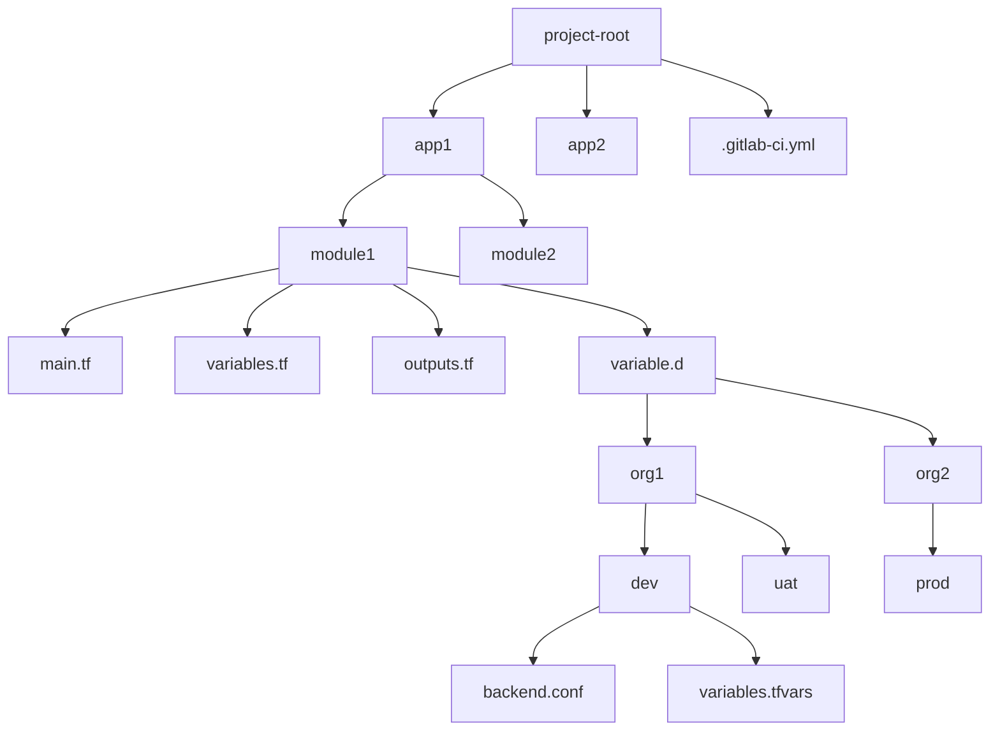

# Environment as Code (EaC) Pipeline Guidelines

## Table of Contents
1. [Folder Structure](#folder-structure)
2. [Pipeline Structure](#pipeline-structure)
3. [Job Naming Conventions](#job-naming-conventions)
4. [Environment Variables](#environment-variables)
5. [Terraform Configuration](#terraform-configuration)
6. [Vault Integration](#vault-integration)
7. [Dynamic Job Generation](#dynamic-job-generation)
8. [Tag-based Deployment](#tag-based-deployment)
9. [Notification System](#notification-system)
10. [Security Practices](#security-practices)
11. [Artifact Management](#artifact-management)
12. [Use Cases](#use-cases)

## Folder Structure

### Standard Project Layout
```text
project-root/
│
├── app1/                  # Application 1
│   ├── module1/           # Module 1
│   │   ├── main.tf              # Main Terraform config
│   │   ├── variables.tf         # Variable declarations
│   │   ├── outputs.tf           # Output definitions
│   │   └── variable.d/          # Environment-specific variables
│   │       ├── org1/            # Organization 1
│   │       │   ├── dev/         # Dev environment
│   │       │   │   ├── backend.conf
│   │       │   │   └── variables.tfvars
│   │       │   └── uat/
│   │       └── org2/
│   │           └── prod/
│   └── module2/
│       └── ...
│
├── app2/
│   └── ...
│
└── .gitlab-ci.yml         # CI/CD pipeline configuration
```
### Stage Flow

## Pipeline Structure

### Stages
The pipeline consists of the following stages:
- `.pre`: Preparation jobs (change detection, job generation)
- `init`: Initialization jobs
- `validate`: Validation and testing
- `security`: Security scanning
- `plan`: Terraform planning
- `deploy`: Deployment (manual by default)
- `notify`: Notification handling
- `cleanup`: Resource cleanup

### Key Jobs
- `detect_changes`: Identifies changed modules/paths
- `generate_dynamic_jobs`: Creates jobs based on changes
- `trigger_dynamic`: Triggers dynamic child pipeline
- `extract_tag_vars`: Processes deployment tags
- `plan`: Terraform plan job
- `deploy`: Terraform apply job
- `notify`: Sends notifications
- `cleanup_tag`: Cleans up deployment tags

## Job Naming Conventions

### Standard Jobs
- `{APP}_{MODULE}_{ORG}_{ENV}_validate`: Validation job
- `{APP}_{MODULE}_{ORG}_{ENV}_scan`: Security scan job
- `{APP}_{MODULE}_{ORG}_{ENV}_plan`: Planning job
- `{APP}_{MODULE}_{ORG}_{ENV}_deploy`: Deployment job
- `{APP}_{MODULE}_{ORG}_{ENV}_notify`: Notification job

### Module-level Jobs
- `{APP}_{MODULE}_unit_test`: Basic unit testing
- `{APP}_{MODULE}_scan`: Security scanning
- `{APP}_{MODULE}_notify`: Notification

## Environment Variables

### Required Variables
- `APP`: Application name
- `MODULE`: Module name
- `ORG`: Organization name
- `ENV`: Environment (dev, uat, prod)
- `VAULT_ENV`: Vault environment
- `VAULT_ADDR`: Vault server address
- `TF_VAR_vault_role`: Vault JWT auth role

### Terraform Variables
- `TF_CLI_ARGS`: Common CLI arguments
- `TF_IN_AUTOMATION`: Set to "true"
- `TF_INPUT`: Set to "false"
- `TF_ROOT`: Project directory
- `TF_CLI_CONFIG_FILE`: Terraform config path

## Terraform Configuration

### Standard Practices
- Always use workspaces (one per environment)
- Store backend config in `variable.d/{ORG}/{ENV}/backend.conf`
- Store variables in `variable.d/{ORG}/{ENV}/variables.tfvars`
- Use `terraform fmt` to maintain consistent formatting
- Validate configurations with `terraform validate`

### Plan/Apply Process
1. Initialize with backend config
2. Select/create workspace
3. Generate plan with `-out` parameter
4. Store plan as artifact
5. Apply only after successful plan

## Vault Integration

### Authentication
- Uses JWT authentication with GitLab CI
- Token obtained via `vault write auth/jwt/login`
- Role configured via `TF_VAR_vault_role`

## Use Cases

### 1. Standard Module Development
**Scenario**: Developer working on a module1 in app1

1. Make changes to Terraform files in `app1/module1/`
2. Push changes to branch
3. Pipeline automatically:
   - Detects changes in `app1/module1/`
   - Runs unit tests and security scans
   - Notifies team of results

**Example Job Flow**:
app1_module1_unit_test → app1_module1_scan → app1_module1_notify

### 2. Environment-specific Deployment
**Scenario**: Deploying module1 to UAT environment

1. Create deployment tag:
   ```bash
   git tag -a deploy-app1-module1-org1-uat -m "Deploy to UAT"
   git push origin deploy-app1-module1-org1-uat

2. Pipeline automatically:
    - Extracts variables from tag
    - Sets up Vault connection for UAT
    - Runs Terraform plan
    - Waits for manual approval
    - Deploys when approved
    - Notifies team
    - Cleans up tag