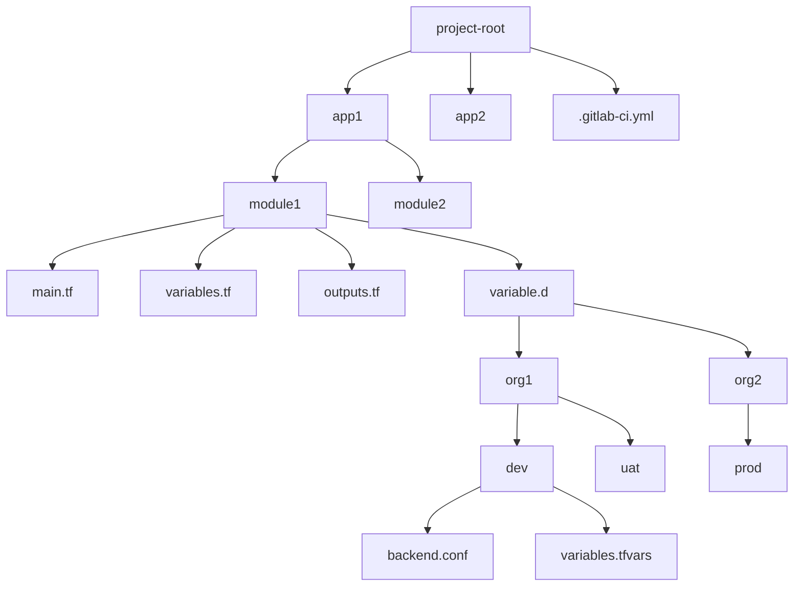

# Infrastructure & Environment as Code Guidelines
CoreCI-IaC-EaC is a comprehensive GitLab CI/CD framework designed for managing and deploying infrastructure using Infrastructure as Code (IaC) principles. It provides automated workflows for both dynamic and tag-based deployments with built-in security features.
## Table of Contents
1. [Folder Structure](#folder-structure)
2. [Pipeline Architecture](#pipeline-architecture)
3. [Deployment](#deployment)

## Folder Structure
### Standard Project Layout
```text
project-root/
│
├── app1/                  # Application 1
│   ├── module1/           # Module 1
│   │   ├── main.tf              # Main Terraform config
│   │   ├── variables.tf         # Variable declarations
│   │   ├── outputs.tf           # Output definitions
│   │   └── variable.d/          # Environment-specific variables
│   │       ├── org1/            # Organization 1
│   │       │   ├── dev/         # Dev environment
│   │       │   │   ├── backend.conf
│   │       │   │   └── variables.tfvars
│   │       │   └── uat/
│   │       └── org2/
│   │           └── prod/
│   └── module2/
│       └── ...
│
├── app2/
│   └── ...
│
└── .gitlab-ci.yml         # CI/CD pipeline configuration
```
### Stage Flow

## Pipeline Architecture
### Stages
The pipeline consists of the following stages:
- `.pre`: Initialization and setup
- `init`: Resource preparation
- `validate`: Validation and testing
- `security`: Security checks
- `plan`: Terraform planning
- `deploy`: Deployment (manual by default)
- `notify`: Notification handling
- `cleanup`: Resource cleanup

### Jobs
The pipeline consists of the following jobs: 
- `detect_changes`: Identifies changed modules/paths
- `generate_dynamic_jobs`: Creates jobs based on changes
- `trigger_dynamic`: Triggers dynamic child pipeline
- `extract_tag_vars`: Processes deployment tags
- `plan`: Terraform plan job
- `deploy`: Terraform apply job
- `notify`: Sends notifications
- `cleanup_tag`: Cleans up deployment tags

## Deployment
### 1. Standard deployment
#### Manual Trigger
- Make changes to the code and push to the repository. `(eg: app1/module1/variable.d/{ORG}/{ENV}/*)`
- The pipeline will automatically detect changes and generate jobs.
- The generated jobs will be triggered by a manual approval.
- The manual approval is required to proceed with the deployment.
#### Job Flow
- Initializes Terraform
- Sets up Vault connection for specified environment
- Runs Terraform plan
- Waits for manual approval
- Deploys when approved
- Notifies team
- Cleans up resources
**Example Job Flow**:
app1_module1_unit_test → app1_module1_scan → app1_module1_notify → app1_module1_plan → app1_module1_deploy → app1_module1_notify → app1_module1_cleanup

### 2. Tag-based Deployment
#### Tag Format
- Tags should follow the format: `deploy_{APP}_{MODULE}_{ORG}_{ENV}`

#### Tag Processing
- Extracts variables from tag
- Sets up Vault connection for specified environment
- Runs Terraform plan
- Waits for manual approval
- Deploys when approved
- Notifies team
- Cleans up tag

**Example Job Flow**:
app1_module1_unit_test → app1_module1_scan → app1_module1_notify → app1_module1_plan → app1_module1_deploy → app1_module1_notify → app1_module1_cleanup
