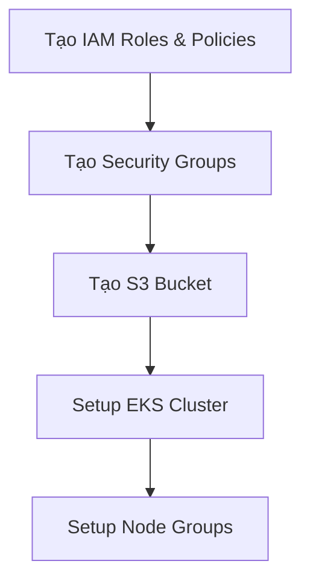

# EKS Setup Workflow

Quy trình triển khai EKS cần thực hiện tuần tự các bước sau để đảm bảo các tài nguyên phụ thuộc được tạo đầy đủ trước khi khởi tạo EKS cluster.

## 1. Chuẩn bị các tài nguyên phụ thuộc (Dependencies)

Trước khi setup EKS, cần tạo các tài nguyên sau:

- **IAM Roles & Policies**  
  Tạo các IAM role và policy cần thiết cho EKS control plane, node group, và các dịch vụ liên quan.

- **Security Groups (SG)**  
  Tạo các security group cho EKS control plane, node group, và các thành phần mạng khác.

- **S3 Bucket**  
  Tạo S3 bucket dùng để lưu trữ remote state cho Terraform hoặc các artifact cần thiết cho EKS.

## 2. Quy trình triển khai

1. **Khởi tạo IAM Roles & Policies**
   - Tạo IAM role cho EKS cluster.
   - Tạo IAM role cho node group.
   - Gán các policy cần thiết.

2. **Khởi tạo Security Groups**
   - Tạo security group cho EKS control plane.
   - Tạo security group cho node group.
   - Cấu hình các rule phù hợp.

3. **Khởi tạo S3 Bucket**
   - Tạo S3 bucket cho remote state hoặc lưu trữ artifact.

4. **Khởi tạo EKS Cluster**
   - Sau khi các dependency trên đã sẵn sàng, tiến hành tạo EKS cluster.
   - Khai báo các subnet, VPC, IAM role, security group đã tạo ở các bước trước.

5. **Khởi tạo Node Groups**
   - Tạo các node group, sử dụng IAM role và security group đã chuẩn bị.

## 3. Minh họa luồng triển khai

## 4. Lưu ý

- Các bước trên nên được thực hiện tuần tự để tránh lỗi thiếu tài nguyên phụ thuộc.
- Có thể sử dụng Terraform để quản lý toàn bộ workflow này, đảm bảo tính tự động và nhất quán.

---